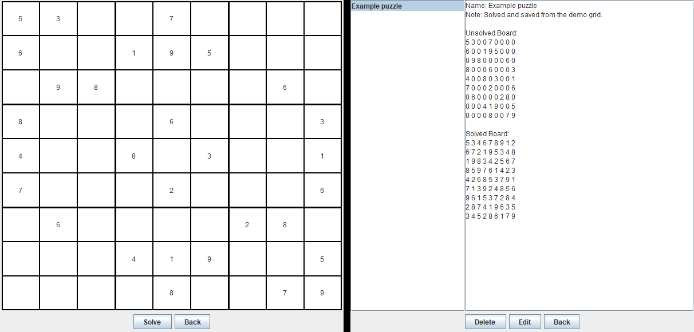

# Sudoku Solver

[](https://github.com/Kiekeku/Sudoku-Solver/actions/workflows/ci.yml)

I built this Java Swing desktop app to solve Sudoku puzzles and save the original puzzle alongside its solution. The solver uses backtracking, and saved puzzles can be named, annotated, and loaded from a local JSON file.



## Run the app

Use PowerShell on Windows with a graphical desktop and a JDK on your PATH. The project was verified with JDK 21. From the repository root, compile and launch the app with the bundled JSON library.

```powershell
.\scripts\run-app.ps1
```

1. Select **Input Board & Solve**, enter the known digits, and leave unknown cells blank.
2. Select **Solve**. When a solution appears, you can save the puzzle and solution together with a name and an optional note.
3. Open **View Saved Boards** to revisit, edit, or delete a saved pair.
4. Use **Save Boards to File** and **Load Boards from File** to write or restore your collection.

## Test Coverage

From the repository root, run the bundled JUnit and JaCoCo tools through PowerShell. The full suite needs a graphical desktop because some tests instantiate Swing windows.

```powershell
.\scripts\run-coverage.ps1
```

On JDK 21, all **47 tests passed** across the solver, JSON persistence, and Swing UI.

| JaCoCo metric | Coverage |
| --- | ---: |
| Lines | 93.11% |
| Branches | 93.56% |
| Instructions | 93.42% |

The script generates an HTML report at `coverage/html/index.html`, along with `coverage/jacoco.xml` and `coverage/jacoco.csv`.

## Design decisions and limitations

The solver uses backtracking and validates the completed board before reporting success. The Swing interface runs solving in a background worker and saves each original puzzle and its solution as a pair in JSON.

Saved-board management currently sits close to the UI. I would separate those responsibilities in a future revision so the collection can be tested and reused independently. See the [original course notes](docs/course-notes.md) for the event-log example and design reflection.

## Sources
https://github.students.cs.ubc.ca/CPSC210/JsonSerializationDemo
